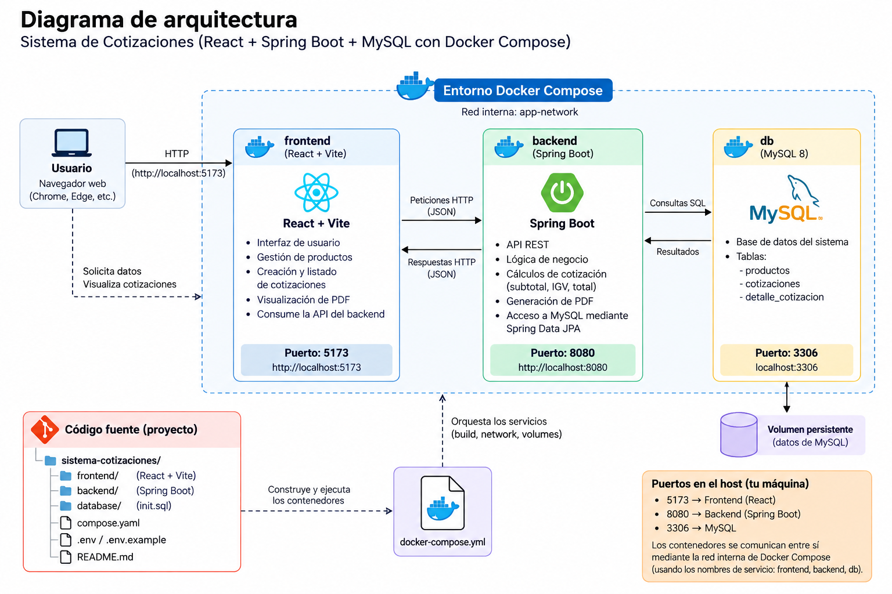

# Sistema de Cotizaciones (React + Spring Boot + MySQL + Docker Compose)

## Levantar todo
```bash
cp .env.example .env      # ya viene un .env listo; edítalo si quieres
docker compose up --build
```
- Frontend: http://localhost:5173
- Backend (API): http://localhost:8080/api/cotizaciones
- MySQL: localhost:3306 (usuario `root`, clave en `.env`)

Si XAMPP ya usa el puerto 3306, cambia `DB_HOST_PORT=3307` en `.env`.

## 🎥 Video demo del sistema
[](https://www.youtube.com/watch?v=DrR1kcsetYs)

## Diagrama de la arquitectura


## Comandos útiles
```bash
docker compose down        # apagar (conserva los datos)
docker compose down -v     # apagar y borrar la base de datos
docker compose logs -f backend
```

## API
| Método | Ruta | Descripción |
|---|---|---|
| GET | /api/cotizaciones | Listar |
| POST | /api/cotizaciones | Crear (calcula subtotal, IGV 18 % y total) |
| PATCH | /api/cotizaciones/{id}/estado | PENDIENTE / APROBADA / RECHAZADA |
| GET | /api/cotizaciones/{id}/pdf | PDF para el cliente |
| GET | /api/productos?soloActivos=true | Listar productos |
| POST / PUT | /api/productos[/{id}] | Registrar / editar |
| PATCH | /api/productos/{id}/activo | Activar / desactivar |
